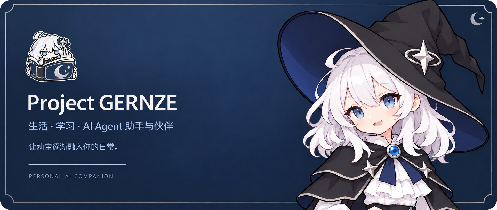
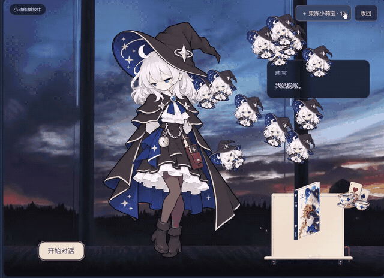
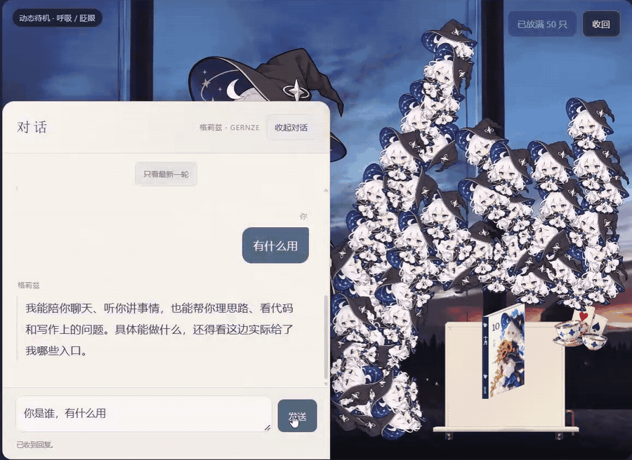
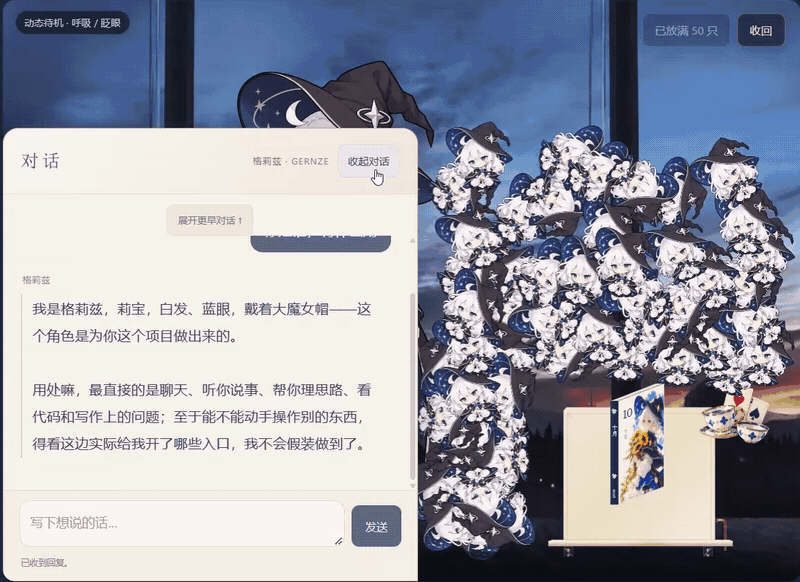
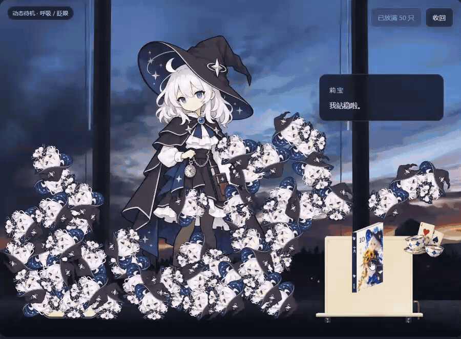
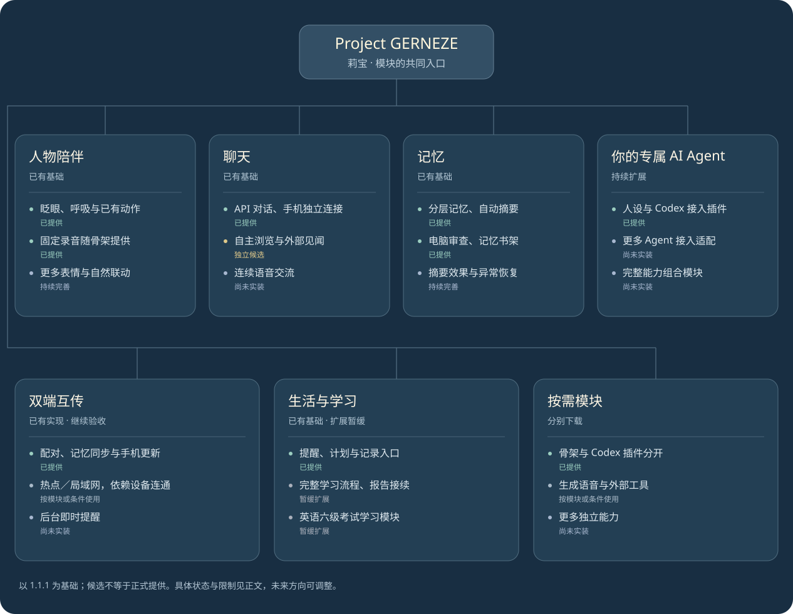

# Project GERNZE

**面向生活与学习的 AI伙伴，也是日常相伴的莉宝，甚至后续可以成为您独有的ai agent助手。**

白毛魔女格莉兹，当然，你也可以叫她莉宝。
她可以待在你的电脑和手机里，和你聊天、回应互动，同时自动整理聊天摘要，供之后的互动参考。我们希望她逐渐融入日常：陪你做事、听你分享，慢慢成为您专属的、有记忆并且能够一起成长的伙伴。

项目围绕人物陪伴、对话、记忆和可选工具（可以按需下载对应模块）逐步开发。
其中，有关学习的模块是一个长期模块方向，具体流程仍在持续整理；你可以按需要使用已有功能，也可以尝试为她增加自己的能力。

深受 [Project AIRI](https://github.com/moeru-ai/airi)、[Neuro-sama](https://www.youtube.com/@Neurosama) 等项目与作品的启发。

[下载与安装](#下载与安装) · [看看莉宝](#看看莉宝) · [当前进度与路线图](#当前进度与路线图) · [开发与参与](#开发与参与)

## 最近更新

以下为近期本地版本记录。首次准备公开的版本是 **1.1.1**，更新记录不代表每个历史版本都已在 GitHub 发布。

- **1.1.1 · 2026-10-22**：电脑端加入独立自动记忆审查，补充同步与审批修复，手机版开场加入版本角标。[详情](docs/release-1.1.1.md)
- **1.1.0 · 2026-10-20**：完善记忆同步、审查与公开构建；手机可上传简版聊天原文，由电脑统一审查。[详情](docs/release-1.1.0.md)
- **1.0.26 · 2026-10-20**：更新手机对话与月册书架，完善记忆同步及独立 Codex 接入插件。[详情](docs/release-1.0.26.md)
- **1.0.24 · 2026-10-19**：接通手机版记忆书架，电脑端将对话和记忆管理分成独立页面。
- **1.0.23 · 2026-10-19**：统一左上图标与底栏按钮的回弹，单击回应一次，连续点击逐步增强。
- **1.0.22 · 2026-10-19**：对话先显示最新一轮，历史按需展开；设置按功能分组收起。
- **1.0.21 · 2026-10-19**：增加可选背景，修复旧审批重放，补齐电脑端基础资料加载。

更多请见 [完整更新与制作记录](docs/development-log.md)。

## 这个项目有什么特别？

**从生活和学习出发，让莉宝在未来的时间内帮助与陪伴您，甚至在后续成为您专属的ai agent管理者。**
你可以从一次次聊天、或是提醒开始，塑造她的记忆和细致性格。
也可以按自己的需要配置莉宝的设定、记忆和工具，让她逐步参与更具体的事情。

电脑端的核心以 **Python** 实现，界面与功能通过明确的接口连接，便于适配不同服务与工具。
其中模型服务、Agent 接入和额外能力可以分别适配，不需要为了尝试一个功能就替换整个项目。同时项目中的基础骨架程序与可选插件分开下载。已有的人物动作和固定录音属于基础程序内容。

**记忆是相处的延续。** 
核心资料、经过审查的记忆、待审聊天摘要和聊天原文分为四层保存，各自承担不同的用途。
日常聊天会按设定的周期整理摘要，但聊天模型不能直接修改核心设定或已审记忆；摘要经过电脑端独立审查后，才可能进入已审核记忆。
如果需要，你也可以在记忆书架里按月份和日期回看已保存的内容。

**电脑和手机可以通过热点或同一局域网互通。** 
首次连接时，用手机端的扫码配对功能扫描电脑更新发布窗口中的二维码。完成配对后，可以手动点击“同步到电脑并接回审核结果”，也可以开启定期同步，默认间隔为 7 天，可自行调整。
同步需要手机在前台、两端网络可互访，并保持电脑更新发布窗口开启。手机上的待审摘要和简版聊天原文会交给电脑统一审查，已有审核结果可在同步时接回手机；新审核结果需要等电脑完成审查后再同步。
电脑发布器也可以向已配对的手机提供更新。更换设备时，仍需重新配置与配对，并处理好已有资料的迁移；记忆同步有助于延续和莉宝的相处。

> [!TIP]
> **没有自己的 API，也能使用吗？**
>
> 可以先使用人物展示、已有动作和本地互动。
> 如果已经在使用 Codex，也可以单独安装和配置现有的莉宝接入插件，让格莉兹的人设与记忆在现有 Agent 对话中参与工作。这种接法不需要在莉宝里另填模型 API Key，但仍受宿主服务的账户、额度和使用条件限制。
>
> Claude Code、DeepSeek Harness 等更多 Agent 的接入适配是后续扩展方向，目前尚未实装。有需要的朋友可以参考仓库源码自行适配。

界面、布局和动画使用 **HTML、CSS、JavaScript** 等 Web 技术。Windows 端由 Python 宿主连接本地功能；Android 端通过 Capacitor 与原生桥连接通知、存储和其他系统能力。这样可以复用界面与部分逻辑，也方便单独调整布局、增加功能。

目前提供 Windows 与 Android 工程。
Android 端可独立连接用户配置的 API，在日常使用时，可以独立于电脑版使用（手机可在本地保存原文、整理摘要，记忆审查及双端同步仍需要电脑配合）。
我们无法逐一覆盖所有手机型号、系统和 WebView 版本，因此会提供源码、构建说明，以及 Mobile MCP、Maestro、Appium、ADB 等工具的参考入口，如果您需要对您的设备做适配，可以让 AI 协助复现问题、修改代码，再在自己的手机上验证，我们会尽量让步骤清楚、容易接手。

> [!NOTE]
> 项目仍处于早期开发阶段，可能仍存在尚未解决的问题，欢迎所有感兴趣的朋友参与，一起让它变得更好。
>
> 即使暂时不熟悉前后端语言或开发工具，也没有关系，作者本人也是一名仍在大学学习的 AI 使用者，只要你对这个项目有想法，就欢迎使用自己熟悉的工具，包括 AI，尝试改进和开发，也可以分享建议与使用体验。
>
> 我们期待并随时欢迎每一位感兴趣的朋友加入。

## 看看莉宝

### 开场与人物互动

眨眼、呼吸、睡眠、抓取与回稳，让她在日常使用中回应你。动作与表情还会继续完善。

**抓取与回稳**

**入睡**

**醒来**

**图标回弹**

### 小莉宝

工作之外，也可以放出小莉宝，看她们落下、碰撞和堆在一起。

### 对话与记忆书架

日常对话从最近的交流开始，按需展开尚未压缩的历史；书架每月一本、每天一页，方便回看已保存的内容。

**翻开日页**

日页展示里的“测试”是演示合成文字，没有展示私人记忆。

## 当前进度与路线图

下图以 **1.1.1 准备公开的范围**为基础。候选表示已有独立小样或代码，但未随该版本正式提供；尚未实装和暂缓项目是后续方向，具体取舍仍会调整。

展开路线图文字版

**人物陪伴**

 已提供：人物显示、眨眼、呼吸、已有睡眠与互动动作、固定录音。  
 持续完善：更多动作、表情与自然联动。  

**聊天**

 已提供：可配置 API 对话，手机独立连接 API。  
 自主浏览与外部见闻：独立候选，尚未正式接入。  
 连续语音交流：完整流程尚未实装。  

**记忆**

 已提供：分层记忆、自动摘要、独立审查、记忆书架。  
 持续完善：摘要与审查效果、异常恢复和双端一致性。  

**你的专属 AI Agent**

 已有基础：用户控制的人设与资料、独立 Codex 接入插件。  
 尚未实装：Claude Code、DeepSeek Harness 等更多接入适配与完整的能力组合模块。  

**双端互传**

 已有实现：配对、热点／局域网记忆同步、手机接收电脑更新。  

*传输条件：设备可互访，前台同步依赖应用运行；更多机型与真实双机流程仍需验证。*

 跨设备后台即时提醒：尚未实装。  

**生活与学习**

 已有基础：提醒、计划与记录入口。  
 暂缓：完整学习流程、学习报告接续、英语六级考试学习模块。  

**按需模块**

 已提供：骨架与 Codex 插件分别分发。  
 持续扩展：语音生成、外部工具及其他独立能力；具体平台支持以各模块说明为准。

## 下载与安装

首次准备公开的版本为 **1.1.1**。

| 平台或用途 | 下载文件 |
| --- | --- |
| Windows 基础程序 | [GERNZE-windows-1.1.1.zip](https://github.com/ingernze/Project-GERNZE/releases/download/v1.1.1/GERNZE-windows-1.1.1.zip) |
| Android 基础程序 | [GERNZE-android-1.1.1.apk](https://github.com/ingernze/Project-GERNZE/releases/download/v1.1.1/GERNZE-android-1.1.1.apk) |
| 可选 Codex 接入插件 | [GERNZE-codex-1.0.0.zip](https://github.com/ingernze/Project-GERNZE/releases/download/v1.1.1/GERNZE-codex-1.0.0.zip) |
| 公开源码 | [GERNZE-source-1.1.1.zip](https://github.com/ingernze/Project-GERNZE/releases/download/v1.1.1/GERNZE-source-1.1.1.zip) |

普通使用只需要对应平台的基础程序，其他插件可按需下载，不会在下载基础程序的时候自动一起安装。
Windows 版解压后运行，保留同目录运行文件；Android 版按系统提示安装 APK。接入 API 对话时，在设置里填写自己的服务地址、模型与密钥。

### 可下载的声音模块

莉宝的本地语音生成基于 [GPT-SoVITS](https://github.com/RVC-Boss/GPT-SoVITS)，由本项目提供接入与音色导入工具。
声音模块按需单独下载；基础程序中的固定录音无需安装此模块就可使用。

我们会为下载声音模块的使用者单独提供一套已经训练好的莉宝音色模型及配套参考音频，方便您直接使用，不必从头训练。
模块与模型的下载入口会在发布时补充，音色及音频的使用范围以配套说明为准。

想训练自己的音色，可以从 [GPT-SoVITS 官方中文说明与教程入口](https://github.com/RVC-Boss/GPT-SoVITS/blob/main/docs/cn/README.md) 开始。训练完成后，准备配套的 GPT／SoVITS 权重、参考音频及对应文本，通过声音模块中的 `导入声音.cmd` 接入。当前已验证的是 V2 Pro 完整导出权重，其他版本需先核对兼容性；莉宝声音模块提供推理与导入，不包含训练界面。

记忆、同步与费用说明

| 记忆层级 | 内容 | 修改范围 |
| --- | --- | --- |
| 第一层 | 核心设定与基础资料 | 所有者维护，回答时带入，日常聊天模型不能写入 |
| 第二层 | 已审核记忆 | 所有者或其明确委派的审查者通过独立入口维护 |
| 第三层 | 从聊天原文整理的待审摘要 | 模型在程序允许的范围内整理，不直接当成已确认事实 |
| 第四层 | 聊天原文 | 程序保存，供回顾、摘要和核对来源 |

摘要和审查间隔可以设置，默认一周、最短一天。电脑独立自动审查默认开启，可以关闭；运行时按条件处理具体条目。手机将摘要与简版原文传到电脑，电脑审查结果再传回手机。同步处理修改、删除与冲突，不只是不断追加；第一层与 API 密钥不随记忆同步传递。

手机端接收更新时需要电脑发布器运行，在下载后的安装仍由使用者在手机端点击安装。

API 对话、自动摘要和模型审查会消耗所配置服务的额度，固定录音随骨架提供；模型生成语音是另一项能力。记忆采用资料保存、摘要与检索，不是重新训练模型，摘要与审查也可能漏记或误判。

## 开发与参与

欢迎提交问题、使用反馈、文档修订、美术与功能改进，使用 AI 协助开发也欢迎，如果可以请说明修改了什么、如何验证，以及哪些部分还没有验证，方便后续的维护与更新。

从 [源码与构建说明](docs/source-package.md)、[分发说明](docs/public-distribution.md) 和 [现行结构入口](docs/architecture.md) 开始。部分文档保留早期记录，当前功能状态优先对照最新版本说明。

- **电脑端**：Python 核心与桌面宿主，工作台界面位于 `src/workbench/static/`；正式启动入口为 `src/desktop_main.py`，构建方式见上方源码说明。
- **手机端**：前端适配位于 `mobile/src/`，Android 宿主位于 `mobile/android/`，网页构建入口为 `mobile/tools/build-web.cjs`。
- **Agent 接入**：从 `agent-bridge/` 的接口与宿主说明入手，独立于默认骨架。

公开源码按白名单导出，不含私人资料，也不包含全部美术、固定录音、模型与构建环境。自行构建前，需要准备依赖与匹配且有权使用的资源。仅修改生成目录，可能在下次构建时被覆盖，应同时核对实际源文件。

### 为自己的手机适配

可按需要选用下列辅助工具，普通使用无需安装：

| 工具 | 可以帮助做什么 |
| --- | --- |
| [Maestro](https://github.com/mobile-dev-inc/Maestro) | 重复执行点击、输入、切页与检查流程 |
| [Mobile MCP](https://github.com/mobile-next/mobile-mcp) | 向 AI 提供设备截图、界面观察和操作入口 |
| [Appium UiAutomator2](https://github.com/appium/appium-uiautomator2-driver) | 进一步定位原生界面或满足条件的 WebView 控件 |
| [Android ADB](https://developer.android.com/tools/releases/platform-tools) | 授权连接设备、安装调试包、读取运行日志 |

如果在您的手机上遇到启动或显示问题，可以借助上述工具，来修复代码，也可让 AI 协助定位和修改代码，重新构建后再到手机上验证。

## 同类项目

这里列出方向相近或曾提供主要参考的项目，不代表本项目已集成它们的所有功能。

- [Project AIRI](https://github.com/moeru-ai/airi)：AI 角色、跨端界面与模块组织的参考。
- [VPet](https://github.com/LorisYounger/VPet)：桌面宠物与动作流程的参考。
- [Open-LLM-VTuber](https://github.com/Open-LLM-VTuber/Open-LLM-VTuber)：AI 角色对话及相关记忆思路的参考。
- [ZerolanLiveRobot](https://github.com/AkagawaTsurunaki/ZerolanLiveRobot)：角色与协议组织的参考。
- [SillyTavern（酒馆）](https://github.com/SillyTavern/SillyTavern)：角色、用户资料与提示组织的参考。
- [DeepSeek Harness](https://github.com/deepseek-ai/deepseek-harness) 与 [dsh-bili-humanism](https://github.com/InariNGT-Ofiicial/dsh-bili-humanism)：相关 Agent 生态与自主浏览、外部见闻的设计参考；本项目对应功能仍是独立候选。
- [Neuro-sama](https://www.youtube.com/@Neurosama)：AI 虚拟角色与长期陪伴方向的启发，链接为官方频道。

以及其他为我们提供过启发的项目。具体参考与实际采用的区分见 [参考与复用清单](docs/reuse-and-attribution.md)。

## 参考与感谢

感谢提供代码、组件、资料、设计思路，以及参与测试和反馈的朋友，项目主要参考来源在上方列出；传输与记忆部分也研究过 LocalSend、LangMem、Letta、Mem0 等项目的做法。

实际采用的第三方组件、署名与许可详见 [参考与复用清单](docs/reuse-and-attribution.md)。

## 隐私与许可

下载公开版会为您提供一份带有格莉兹基础角色模板和空白个人资料。

本地保存不等于资料永远不离开设备：使用模型功能时，必要的设定、对话和相关记忆会发送给所配置的服务；同步时，允许传输的内容会发送给已配对设备。

自有代码采用自定义非商业许可，允许个人非商业使用、修改和免费分享，商业使用须事先取得作者书面许可。
**这是源码可见项目，不采用 MIT 或无限制授权。** 
插画、图标、动画、录音、模型及完整角色设定不在代码许可范围内；第三方内容遵守各自原许可。

详见 [LICENSE](LICENSE)、[代码与素材使用范围](docs/licensing.md)。

作者：**ingernze**
